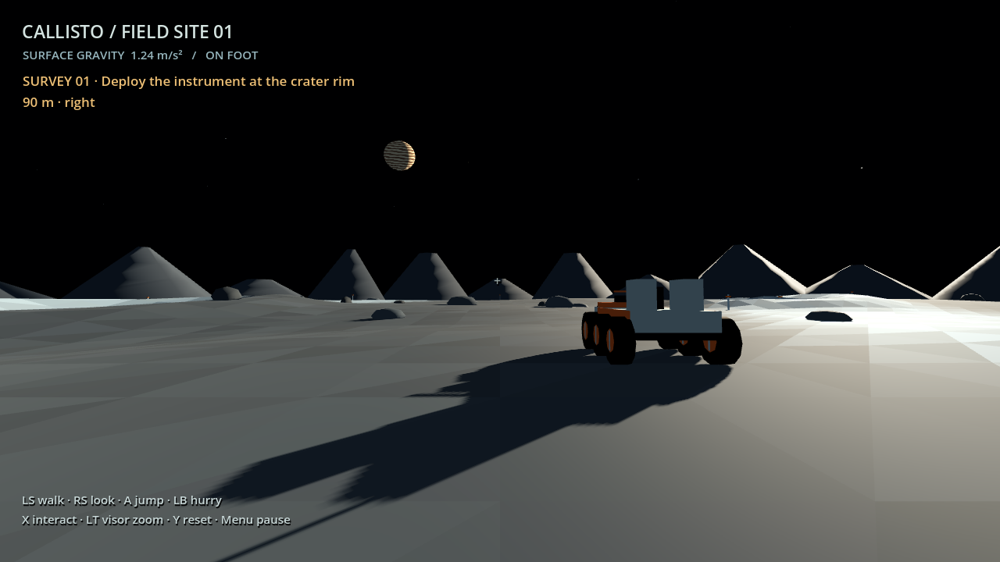
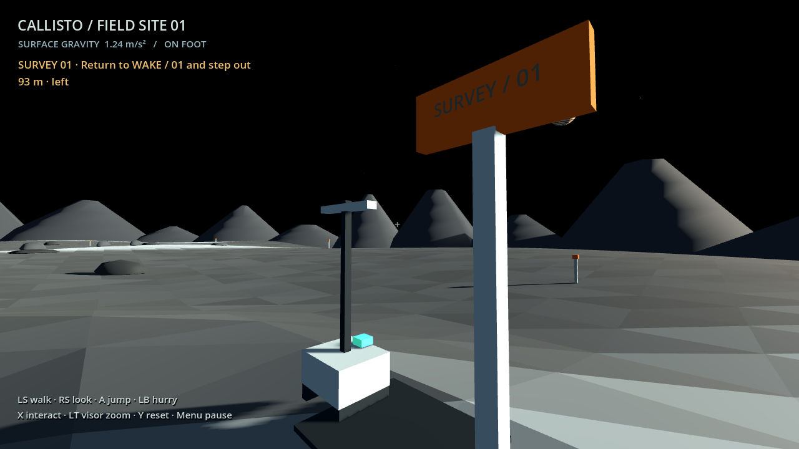

# Jovian Wake — Callisto Playground

A small first-person Godot 4 experiment: stand on Callisto, see Jupiter, drive a six-wheel rover to a crater, deploy a survey instrument on foot, and return to the landing module.



**[Play in your browser](https://kileader.github.io/jovian-wake-callisto/)** · **[GitHub repository](https://github.com/kileader/jovian-wake-callisto)**

This is a separate project from the working [TypeScript cruise deckbuilder](https://github.com/kileader/jovian-wake). It tests movement, scale, and rover feel; it does not commit Jovian Wake to a survival/crafting game or a particular long-term design.

## Play in a browser

Open the browser link above in a desktop browser with WebGL 2 support. Click the game to begin and capture the mouse. For a gamepad, press a button to let the browser detect it, then use **Menu / Start** to resume the game. The same survey and controls are available as in the Windows build. Browsers can differ in controller mappings; reconnecting the controller and pressing a button can help detection.

Esc pauses/releases the mouse; click the game to capture it again. This prototype has no touch controls. It needs no account, API key, or paid inference.

The Pages workflow imports Godot 4.7.2, runs the gameplay checks, exports a single-threaded Compatibility/WebGL build, and deploys it on pushes to `main`. This does not require custom cross-origin isolation headers. Windows builds remain local generated artifacts; the repository contains the source and documentation.

## Play on Windows

Double-click **`Play.cmd`**. It launches the current exported game, or finds a local Godot installation and runs the source. This workspace's existing Spiritbound/Range Club Godot installation is also detected.

You can run **`builds/windows/CallistoPlayground-v0.3.exe`** directly without the editor. Keep its adjacent `.pck` file with it. The generated build is ignored by Git. Earlier executables remain available so an ongoing playtest is not interrupted; `Play.cmd` prefers v0.3. Close the old window and relaunch to use the crater survey and corrected module sign.

To edit the prototype, import `project.godot` in **Godot 4.7.2 Standard** and press **F5**. The Compatibility renderer requires OpenGL 3.3; no plugins or downloaded assets are needed.

## Gamepad controls

Use a standard Xbox-style gamepad. Hot-plugging works through Godot's controller support; use any stick or button to switch the HUD prompts.

| Action | On foot | In the rover |
| --- | --- | --- |
| Left stick | Walk | Steer; forward/back also drives |
| Right stick | Look | Look around the cockpit |
| A | Jump | — |
| X | Enter nearby rover / deploy the survey instrument | Exit and park rover |
| LB | Move faster while held | — |
| RT / LT | LT: hold visor zoom | Forward / reverse, with analog throttle |
| B | — | Brake |
| Y | Reset the landing site | Reset the landing site |
| Menu / Start | Pause / resume | Pause / resume |

The sticks have deadzones and the look stick uses a gentle response curve for fine aiming. The game starts directly in first person; the whole loop works without a mouse. Focus loss pauses movement; Menu resumes. Pause is a small overlay, not a menu system.

## Keyboard and mouse

WASD moves or drives; mouse looks. Space jumps on foot and brakes in the rover. E enters/exits or deploys the instrument near Survey 01. Shift moves faster on foot. Hold the right mouse button for visor zoom. R resets. Esc pauses or resumes; clicking the window also resumes after mouse release.

## Crater survey

1. Enter the rover with **X / E**. Follow the objective's distance and left/right/ahead/behind guidance toward the crater rim. Orange stakes suggest a clear driving approach and a parking area.
2. Park near the exposed blue ice and exit. Cross the shallow crater to the orange **SURVEY / 01** marker on the far rim.
3. Stand near the marker and press **X / E** to deploy the instrument. It appears beside the marker, and the objective switches to returning home.
4. Return to **WAKE / 01**, exit the rover, and approach the module's door. The survey completes; free exploration continues.

**Y / R** resets the whole trip and removes the deployed instrument. The survey has no countdown, inventory, resource cost, or persistent save. Deployment requires nearby grounded footing and is blocked while paused or seated. Completion requires returning on foot; driving past home alone does not finish it.



## What's in the playground

- A fixed 240 m terrain mesh with shallow craters, rocky obstacles, ice-colored facets, distant rim silhouettes, a small landing module, and survey markers.
- Black sky with Jupiter, the Sun, Io, Europa, and Ganymede. Radii and observer distances determine their apparent sizes. Jupiter is approximately 4.35° across; the small solar disk has a little optical glare so it is findable. Their static arrangement is a chosen circular-orbit approximation, not an ephemeris for a real date.
- Astronaut gravity of **1.24 m/s²**. A modest 1.65 m/s jump gives roughly 1.1 m of rise and 2.7 seconds of flight on flat ground. Jumping preserves horizontal momentum: no midair steering or braking. Ground contact restores control. You can still look around during flight.
- An arcade rover with six visual wheels, a cockpit view, analog throttle, steering, brakes, ground collision, and visual chassis tilt. Top speed is 11 m/s; reverse is capped at 4.5 m/s. Its collider stays upright; there is no simulated suspension or wheel traction.
- Exits check several sides and refuse blocked or unsafe steps. Boundary colliders keep both bodies on the finite map; reset provides immediate recovery.

The terrain is an authored mathematical playground, not a reconstruction of Callisto. Ambient fill light, movement control, and rover contact are artistic/playability choices, not a physical simulation. The scene depicts a location on the Jupiter-facing side: [NASA's Callisto overview](https://science.nasa.gov/jupiter/jupiter-moons/callisto/facts/) describes its tidally locked rotation. The mesh and materials are generated locally with built-in Godot resources.

## Verify and export

```powershell
.\tools\godot.ps1 check
.\tools\godot.ps1 test
.\tools\godot.ps1 windows
.\tools\godot.ps1 web
.\tools\godot.ps1 capture
```

Set `CALLISTO_GODOT` or pass `-GodotPath 'C:\path\to\godot.exe'` to choose another compatible engine. Windows export needs matching Godot export templates. Captures require a graphical renderer and write ignored PNGs to `artifacts/`.

For a local browser preview after exporting Web, run `node tools/preview-web.cjs` and open `http://127.0.0.1:4175/jovian-wake-callisto/`.

Automated checks run the actual 3D collision world and simulated keyboard/gamepad events. They cover landing, walking/stopping, jump/gravity and conserved horizontal momentum, rover range and seating, trigger driving/reverse, steering/braking, stick drift/look, visor zoom, pause/reset, blocked exits, terrain boundaries, crater collision, fall recovery, astronomical apparent sizes, driving the survey approach, deployment restrictions, returning, and resetting the excursion. They do not establish physical controller compatibility or perceived handling comfort. Those require manual playtesting.

On October 13, 2026, all **71 checks** passed in both source and exported Windows-pack runs. Godot import/export and a Windows executable startup check completed without script/runtime errors. Actual rendered views were inspected on foot, at the corrected building sign, approaching the rover, in the cockpit, after exit, through the visor, and during each survey stage. The original exported game's native window was inspected. Physical gamepad feel and whether the trip is fun remain manual playtest items.

## Code map

| File | Responsibility |
| --- | --- |
| `game/playground.gd` | World setup, interaction, safe exit, reset, pause, input routing |
| `game/survey.gd` | One crater excursion, instrument visuals, deployment/return state, guidance |
| `game/terrain.gd` | Immutable height field, low-poly mesh, matching ground collider |
| `game/astronaut.gd` | First-person camera, walking, jumping, low gravity |
| `game/rover.gd` | Primitive rover model and arcade movement |
| `game/controls.gd` | Keyboard and Xbox-style input mappings |
| `game/hud.gd` | Minimal controls, interaction prompts, pause overlay |
| `game/sky.gd` | Physical angular sizes, static Sun/moon arrangement, sky meshes |
| `game/jupiter.gdshader` | Procedural cloud bands |
| `game/sun_glare.gdshader` | Small optical glare around the solar disk |
| `tests/` | Physics/input checks and rendered view captures |

Movement uses Godot's [CharacterBody3D](https://docs.godotengine.org/en/stable/classes/class_characterbody3d.html); gamepad mappings use its [controller input support](https://docs.godotengine.org/en/stable/tutorials/inputs/controllers_gamepads_joysticks.html).

## First playtest

1. Look up at Jupiter, walk around, and try a jump. Does the movement feel floaty without being tedious?
2. Approach the rover and use X / E. Drive over the shallow crater slopes, steer, reverse, and brake.
3. Look around from the cockpit. Exit, walk away, and reenter. Try Y / R and Menu / Esc.
4. Check a physical controller's sticks, triggers, buttons, hot-plugging, and comfortable look speed.
5. Finish the crater survey. Is the direction guidance sufficient? Does parking and getting out make the trip more interesting? Is the walk across the crater enjoyable?

No inventory, crafting, survival meters, progression, AI services, voxel framework, or networking is included.
